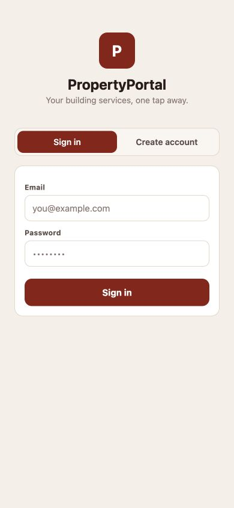
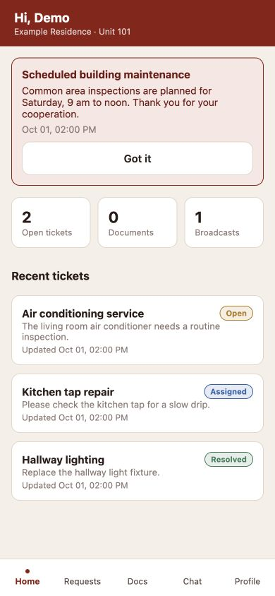
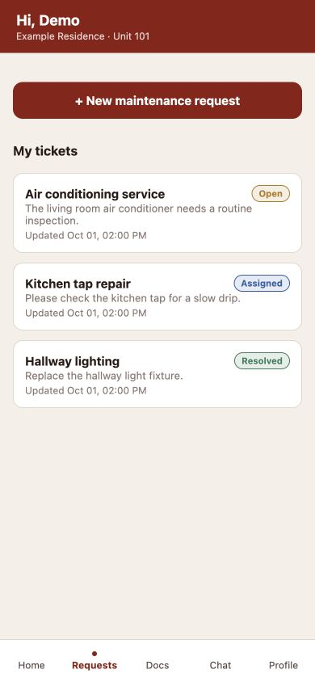
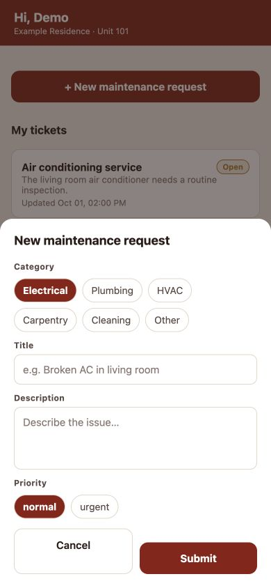

# Property Portal · Mobile

A resident services app built with **Expo, React Native and TypeScript**. Residents can report maintenance issues, follow their progress, talk to building staff, and read building announcements from one interface.

[Mobile app](https://github.com/earlyad4/property-portal-mobile) · [API server](https://github.com/earlyad4/property-portal-server) · [Desktop console](https://github.com/earlyad4/property-portal-desktop)

## Screenshots

Captured from the actual application running in Expo's web preview at a mobile viewport. Every name, building and ticket shown is synthetic; these are not native-device captures.

| Sign in | Resident home |
| --- | --- |
|  |  |

| Request tracking | New maintenance request |
| --- | --- |
|  |  |

## Features

- Resident registration and sign-in, with building and unit selection.
- Maintenance requests with category, description and priority.
- Ticket status tracking and conversations with staff.
- Building announcements and acknowledgement.
- Document status viewing, resident profile and account-access deletion requests.
- Native device session storage and optional Expo push/Sentry integrations.

## Try the interface without a database

Install **Node.js 22.12+** and npm. Clone both this repository and the server repository.

Start the synthetic, read-only preview API in the server checkout:

```sh
npm run demo
```

In this repository:

```sh
npm ci
cp .env.example .env
```

Set these two values in `.env`:

```dotenv
EXPO_PUBLIC_API_BASE=http://127.0.0.1:4318
EXPO_PUBLIC_WS_BASE=ws://127.0.0.1:4318
```

Then run:

```sh
npm run web
```

Sign in with `resident@example.com` and any non-empty sample password. Preview sign-in only selects synthetic fixtures; it does not authenticate a real account. Explore Home, Requests, Docs, Chat and Profile. Mutations, realtime messages and push delivery are unavailable in this read-only preview. Web sessions are held in memory and reset on reload.

## Connect the full application

1. Follow the server README to configure an empty Supabase project, apply the schema and create an operator.
2. Use the desktop console to add a building before registering a resident.
3. Copy `.env.example` to `.env` and set the API and WebSocket origins to your server. On a physical phone, `localhost` means the phone itself; use a reachable development host or your HTTPS/WSS deployment.
4. Install dependencies with `npm ci`.
5. Run `npm run android` or `npm run ios` to create a native development build (Android SDK or macOS/Xcode required). `npm start` starts the Expo development server afterward.
6. Choose **Create account**, select a building, enter a unit and your own test account details. Submit a maintenance request, then manage it in the desktop console.

The clients talk to the API server. Server secrets must never be placed in `EXPO_PUBLIC_` variables. Optional Sentry values are listed in `.env.example`; push delivery requires your own Expo project/device configuration.

## Release and checks

```sh
npm run typecheck
npm test
```

`eas.json` contains development, preview and production profiles. Before `npm run validate:release`, provide `EXPO_PUBLIC_API_BASE` with HTTPS, `EXPO_PUBLIC_WS_BASE` with WSS, and `EXPO_PUBLIC_RELEASE_ID`. Replace the example bundle/package identifier in `app.json` with one you own before store submission. Configure your own Expo/EAS account, signing and optional error reporting.

## Scope and limitations

The browser preview demonstrates the UI; native keychain, notifications and store builds need device testing. Document viewing exists, but the mobile UI does not implement a general file upload flow. Account deletion currently schedules access disablement after 30 days and retains operational records; it is not a full data-erasure workflow. No production-readiness claim is made by the screenshots.

## Public source edition

This repository contains application source and configuration templates. It includes no production database, tenant roster, uploaded documents, backups, credentials, deployment identifiers, or previous Git history. All preview records are newly created synthetic examples. Supply your own infrastructure and accounts for a connected installation.
